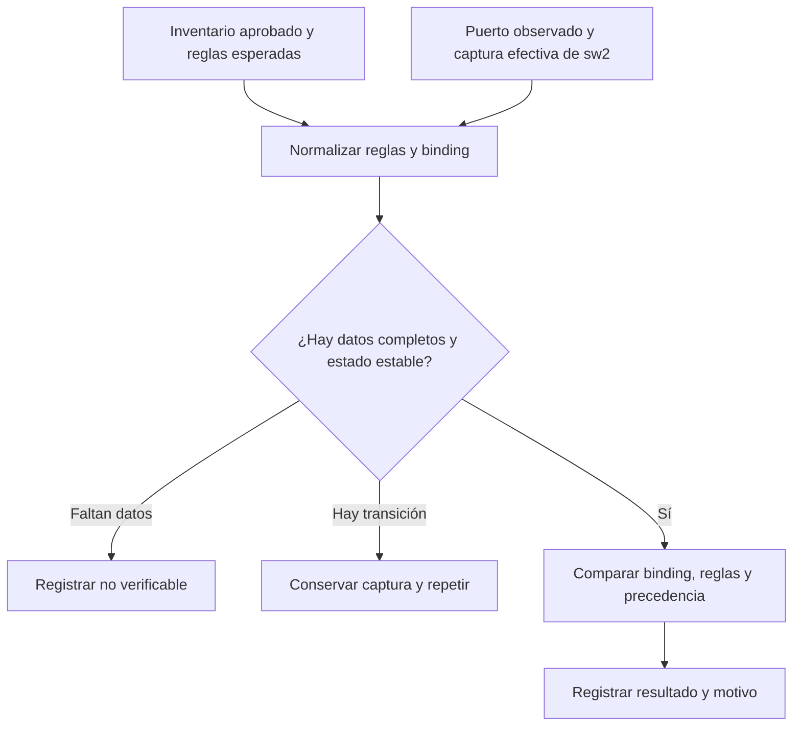

# R3 y coherencia de reglas en VNRT

## Diseño técnico

El objetivo es detectar discrepancias entre el inventario aprobado, las reglas que genera R1/R2 y lo que ejecuta el switch. El binding de R3 comprueba que el puerto observado del switch corresponda a la combinación IP y MAC registrada. Una observación sin puerto físico se registra como no verificable.

El trabajo usa Python 3.12, las estadísticas OpenFlow de Floodlight y el inventario de la topología D. El validador calcula sus resultados sobre datos normalizados y puede probarse con entradas sintéticas. En `app`, el capturador reutiliza el generador vigente y el lector de estadísticas que ya utiliza R1/R2. La observación compara dos capturas de las reglas permanentes de `sw2` en las tablas 10, 20 y 30. El modo de comparación con revisión y generaciones requiere esos datos como entrada para evaluar reglas de sesión. Una comparación marcada como transitoria se repite con una referencia vigente.

| Función | Entradas | Salida |
| --- | --- | --- |
| `check_binding()` | IP, MAC y puerto observados, concesión del inventario | Binding válido o incompatible. La ausencia de puerto produce un rechazo identificable. |
| `compare_snapshot()` | Reglas esperadas y observadas, revisión y generaciones antes y después | Estado, reglas faltantes o inesperadas y conflictos de precedencia. |
| `capture()` | Generador activo, inventario y estadísticas efectivas de `sw2` | Evidencia JSON con versiones, capturas y resultado de las reglas permanentes. |

### Diagrama de decisión

La adaptación de SPHINX consiste en formular invariantes verificables. La identidad se comprueba contra el puerto físico y las reglas efectivas deben conservar la selección de tráfico, la acción y la vigencia esperadas. El alcance de esta entrega se limita a las fuentes y tablas descritas. El capturador trabaja en modo observación. Para mantenimiento se vuelve a ejecutar la misma suite y se registra el hash de la nueva referencia antes de comparar.

## Estrategia de validación

- **Binding.** Probar una observación correcta, IP incorrecta, MAC incorrecta, puerto distinto y puerto ausente. Usar un ejemplo sintético con la función R3 que está instalada en `app`.
- **Reglas y precedencia.** Probar representaciones equivalentes, regla ausente y alteraciones de match, máscara, tabla, acción o tiempo de expiración. Para un bloqueo selectivo, evaluar reglas competidoras del mismo switch y tabla y detectar prioridades iguales o superiores que se solapan.
- **Transiciones.** Probar ambas generaciones válidas durante la renovación, cambio de revisión mientras se captura y retiro legítimo tras logout. Conservar como no verificables las capturas incompletas o que usen una referencia desactualizada.
- **Integración.** Contrastar las reglas permanentes de `sw2` con el generador activo mediante dos lecturas de estadísticas. La prueba de coexistencia con un bloqueo temporal requiere evidencia aparte del flujo de ensayo y de la continuidad de LMS y Notas en `h1`.

Las fichas se identifican con `3.Y.Z`. Estos casos complementan la matriz de los doce códigos obligatorios de R1, R2 y R5 del Grupo 2.

## Resultados iniciales

- **Unitarias en VNRT.** Pasaron las 14 pruebas ejecutadas en `app`, con `check_binding()` importada de `/opt/sdn-p03`. El archivo `resultados/unitarias_vnrt.txt` conserva la salida original.
- **Captura efectiva de sw2.** Las dos lecturas coincidieron. Se encontraron las cinco reglas permanentes esperadas en las tablas 10, 20 y 30. El archivo `evidencias/sw2_linea_base.json` conserva el resultado y las huellas del inventario y del generador.
- **Cobertura en VNRT.** `trace` midió en `app` 79 % de líneas de `coherencia.py` y 28 % del módulo completo `r3.py`. Esta suite se centra en la lógica de binding de R3. La salida está en `resultados/cobertura_vnrt.txt`.
- **Coexistencia con bloqueo temporal.** Caso 3.3.2 aprobado el 23 de noviembre de 2026. El flujo TCP de ensayo conectó antes, agotó el tiempo de espera durante el DROP y volvió a conectar después. LMS y Notas dieron HTTP 200 en las tres fases. El retiro se confirmó en Floodlight y en sw2. Evidencia en `evidencias/g2-lab7-adrian-332-480cf14ebf6c.json`.
