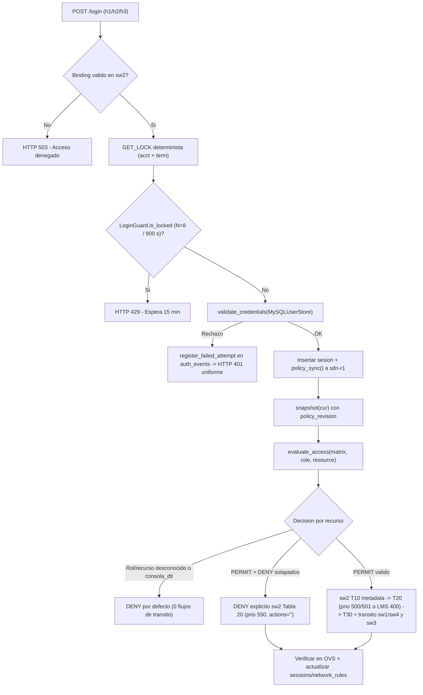

# Diseño Técnico de los Módulos R1 y R2 — Lab 7 (Matthew Salvador, Grupo 2)

## 1. Selección de tecnologías y restricciones

| Componente | Tecnología elegida | Justificación | Restricciones afrontadas |
|---|---|---|---|
| Lógica compartida R1/R2 (`access/`) | Python 3.12 (biblioteca estándar `hashlib`, `hmac`, `re`, `dataclasses`, `threading`, `ipaddress`) | Cero dependencias externas en el núcleo de decisión; permite ejecutar exactamente las mismas funciones tanto en pruebas unitarias aisladas como en producción (`app`). | Compatibilidad obligatoria con hashes existentes en MySQL generados por Werkzeug 3.0.1 (`scrypt:32768:8:1` y `pbkdf2:sha256`). |
| Portal cautivo y consola DTI | Flask + Gunicorn sobre HTTPS (TLS) en `app` (`192.168.10.10:443` y `192.168.0.20:8443`) | Separación física/lógica entre red de datos (`192.168.10.0/24`) y red de gestión (`192.168.0.0/24`). | Conservación obligatoria de CSRF, cookies `Secure/HttpOnly/SameSite=Strict`, cabeceras CSP/X-Frame-Options y binding de red. |
| Persistencia | MySQL (`sdn_g2`) vía `pymysql` con consultas parametrizadas (`%s`) y locks `GET_LOCK` | Persistencia transaccional de `users`, `roles`, `role_permissions`, `resources`, `sessions`, `auth_events`, `network_rules`, `policy_revision` y `admin_accounts`. | Bloqueo `N=8 / 900 s` debe persistir ante reinicios de proceso y serializar solicitudes concurrentes sin deadlocks ni concatenación SQL. |
| Plano de control y datos | Floodlight 1.2 (OpenFlow 1.3, puerto `6653`) + Open vSwitch (`br-sdn` en `sw1`–`sw5`) | Único controlador activo sobre Topología D con pipeline multitabla real en `sw2` (tablas `0 → 10 → 20 → 30`). | Las reglas de sesión tienen `hard_timeout ≤ 30 s` y renovación sin corte por generaciones (`priority=500/501`); no se permiten atajos en tabla `0` de `sw2`. |
| Pruebas y cobertura | `unittest` + `trace` (stdlib Python) | Reproducible sin instalar dependencias adicionales en `app` ni en estaciones locales. | Distinguir claramente pruebas unitarias, integración simulada e integración real en VNRT. |

---

## 2. Despliegue real y mantenimiento

### 2.1 Arquitectura de despliegue (Topología D)
- **VM `app` (`192.168.0.20` / `192.168.10.10`):** ejecuta tres servicios `systemd` separados bajo usuario sin privilegios `sdnportal`:
  1. `sdn-portal.service`: `gunicorn --workers 1 --threads 2 --bind 192.168.10.10:443 ... vnrt_mt_portal:app` (`/opt/sdn-portal-paso4/`).
  2. `sdn-r1.service`: `python3 /opt/sdn-portal-paso4/vnrt_mt_adapter.py` (escucha en socket UNIX `/run/sdn-r1/policy.sock`).
  3. `sdn-admin.service`: `gunicorn --workers 1 --threads 2 --bind 192.168.0.20:8443 ... vnrt_avz7_admin:app` (`/opt/sdn-admin-paso7/`).
- **VM `floodlight` (`192.168.0.10`):** ejecuta `sdn-floodlight.service` en puerto `6653` (controla `sw1`–`sw5`).
- **VM `suricata` (`192.168.0.30`):** sensor IDS y colectores (módulo R5/E02, fuera del plano de edición de R1/R2).

### 2.2 Operación normal (día a día)
1. El cliente (`h1`/`h2`/`h3`) autentica en `https://192.168.10.10/` (`sdn-portal`).
2. `sdn-portal` verifica binding de switch/puerto, consulta bloqueo `8/900 s` en `auth_events`, valida credenciales con `access.validate_credentials()`, crea la sesión en `sessions` y solicita `{"action":"sync"}` a `sdn-r1`.
3. `sdn-r1` (`vnrt_mt_adapter.py`) toma una instantánea consistente con `policy_revision`, evalúa permisos con `access.evaluate_access()`, traduce el pipeline multitabla con `access.translate_policy()`, verifica en OVS y renueva cada 10 s alternando generaciones (`500`/`501`) sin corte de tráfico.
4. La consola DTI (`sdn-admin`, `192.168.0.20:8443`) gestiona revocaciones y cambios de matriz únicamente desde la red de gestión, autenticando contra `admin_accounts`/`admin_sessions`.

### 2.3 Actualización de un módulo y retorno seguro (mantenimiento)
1. **Respaldo previo con verificación de hashes:** copiar `/opt/sdn-portal-paso4/` a `/opt/sdn-portal-paso4.bak-<fecha>/` y registrar `sha256sum`.
2. **Validación previa aislada:** ejecutar `python3 -m unittest discover -s tests -t . -v` antes de reiniciar servicios.
3. **Despliegue controlado:** copiar el paquete `access/` y los módulos actualizados (`vnrt_portal_paso5.py`, `vnrt_mt_adapter.py`) conservando propietario/permisos, reiniciar `sdn-r1` y luego `sdn-portal`, y validar `/health` y `systemctl is-active`.
4. **Retorno seguro (rollback):** restaurar desde `/opt/sdn-portal-paso4.bak-<fecha>/` y reiniciar `sdn-r1` y `sdn-portal` sin restaurar volcados antiguos de sesiones SQL (las sesiones vigentes o nuevas se reconcilian automáticamente contra Floodlight/OVS).

---

## 3. Cadena de llamadas real identificada (`m1`)

- **Portal (`sdn-portal`):** `vnrt_mt_portal.py` → `vnrt_avz7_portal.py` → `vnrt_portal_paso5.py` → `vnrt_portal_paso4.py`
  - `POST /login`: `vnrt_avz7_portal.login()` (verifica `adapter.binding(client)`) → `vnrt_portal_paso5.login()` → `access.MySQLFailureStore.acquire_locks()` → `access.LoginGuard.is_locked()` → `access.validate_credentials(MySQLUserStore(cur), ...)` → `policy_sync()`.
  - `GET /panel`: `vnrt_avz7_portal.panel()` → `vnrt_mt_portal.identity()` + `policy_sync()`.
  - `POST /logout`: `vnrt_portal_paso5.logout()` → revoca sesión en MySQL + `policy_sync()`.
- **Adaptador (`sdn-r1`):** `vnrt_mt_adapter.Reconciler.sync()` → `enforce()` → `snapshot(cur)` (verifica `policy_revision`) → `access.load_access_matrix_from_rows()` → `access.evaluate_access()` → `access.translate_policy()` → `red.push()` + `red.verify_actual()`.
- **Consola DTI (`sdn-admin`):** `vnrt_avz7_admin.py` → `vnrt_admin_paso7.py` (`identity()` y `authorized()` sobre `admin_accounts`/`admin_sessions`), vinculado a `access.dti.evaluate_dti_console_access()`.

---

## 4. Descripción, funciones, APIs y diagrama de flujo

### 4.1 Criterios atendidos
- **R1 (Control de acceso por rol):** autenticación contra repositorio persistente (`users`+`roles`), rechazo uniforme sin enumeración ni inyección SQL, bloqueo por fuerza bruta (`N=8` fallos / `900 s`) y preservación de sesión activa sin interrupción.
- **R2 (Restricción de recursos privilegiados):** decisión `PERMIT`/`DENY` por rol y recurso (`lms`, `notas`, `administracion`), denegación por defecto para roles/recursos desconocidos, separación estricta respecto a `consola_dti` y precedencia de `DENY` sobre `PERMIT` en el pipeline OpenFlow multitabla real.

### 4.2 Contratos / APIs internas del paquete compartido `access/`

| Función / Clase | Entrada | Salida | Dependencias |
|---|---|---|---|
| `validate_credentials(store, username, password)` | `UserStore`, `str`, `str` | `AuthResult(ok, user_id, role, message, role_id)` | `verify_password`, `DUMMY_HASH` |
| `verify_password(stored, password)` | `str`, `str` | `bool` (nunca lanza excepción) | `hashlib.scrypt`, `pbkdf2_hmac`, `hmac.compare_digest` |
| `LoginGuard.register_failed_attempt(user, ip, now)` / `is_locked(now, user, ip)` | `username`, `terminal_ip`, `datetime` UTC | `None` / `bool` (`N=8`, ventana `900 s`) | `FailureStore` (`MemoryFailureStore` o `MySQLFailureStore`) |
| `evaluate_access(matrix, role, resource)` | `AccessMatrix`, `str`, `str` | `AccessDecision(Decision, role, resource, reason)` | `ROLE_CODE_MAP`, `CAMPUS_ROLES` |
| `evaluate_dti_console_access(account, request_ip)` | `Optional[DTIAccount]`, `str` | `AccessDecision(PERMIT/DENY, ...)` | `ipaddress` (red de gestión `192.168.0.0/24`) |
| `translate_policy(policies, client, session_id, seconds, generation, core_switch)` | `Iterable[PolicyEntry]`, `Client`, parámetros de sesión | `List[dict]` (flujos OpenFlow 1.3 para `sw2` T10/T20/T30 + `sw1`/`sw4` + `sw3`) | `session_context`, `DENY_PRIORITY=550`, `PERMIT_PRIORITY_BASE=500` |
| `effective_table20_decision(flows)` | `Iterable[dict]` | `Dict[match_key, Decision]` | `effective_actions` |

### 4.3 Diagrama de flujo (autenticación, autorización y traducción multitabla)

---

## 5. Cambios de comportamiento respecto al avance anterior

1. **Bloqueo `R1-03` unificado (cuenta + terminal):** el portal desplegado originalmente (`vnrt_portal_paso5.py`, SHA-256 `bb2c6b34...`) contaba 8 fallos en 15 min únicamente por `terminal_ip`. La versión integrada aplica **N = 8 fallos en 900 s por cuenta O por terminal**, persistido en `auth_events` y serializado con `GET_LOCK` determinista en ambos identificadores (`sdn-r1-acct-<user>` y `sdn-r1-term-<ip>`).
2. **Traductor `R2-03` alineado al pipeline multitabla real:** el prototipo `access/translate.py` de partida (SHA-256 `5b9e30cd...`) emitía reglas unidireccionales en `table=0` con prioridades `400`/`450`. La versión integrada genera el pipeline real de `sw2` (tablas `10 → 20 → 30` con `metadata` de 64 bits y generaciones `500`/`501`) más tránsito ida/retorno en `sw1`/`sw4` y `sw3`, situando los `DENY` explícitos en tabla `20` con **`priority = 550`** (`> 501 > 400`) y `actions = ""` sin `goto_table`, garantizando que ninguna renovación o regla compartida `lms-shared-sw2` anule una denegación.
3. **Mapeo de roles y separación de consola DTI:** se normalizan los códigos reales de MySQL (`estudiante`, `docente`, `administrativo`, `visitante`) y se impone por código que ningún rol de campus (incluido `administrativo`, que accede a `administracion` en `h4:8443`) pueda obtener `PERMIT` sobre `consola_dti` (`192.168.0.20:8443`).

---

## 6. Limitaciones y aporte bibliográfico

- **Limitaciones y alcance real (Fase A + Fase B completadas el 22/11/2026):** las 26 pruebas ejecutadas validan la lógica compartida `access/` (unitarias + integración con Werkzeug real + simulación SQL/DTI/OVS, cobertura `trace` ~95.4 % sobre 651 líneas; `1.211 s` en local y `6.744 s` en `app`). Durante la **Fase B** en VNRT se desplegó el paquete en `app:/opt/sdn-portal-paso4/` y se validaron en vivo los 4 roles, `logout`, el bloqueo `8/900 s` `h1+h2 → HTTP 429` y la revocación selectiva DTI (`run_id: lab7-matthew-phaseB-1795327118`). En operación normal MySQL actúa como lista blanca (las denegaciones caen en `miss-20`), por lo que la precedencia `DENY prio 550` se acredita en unitarias y simulación multitabla.
- **Aporte de Unidad 09 (diap. 20–22 y 55):** diseño de funciones pequeñas y puras con inyección de dependencias (`UserStore`, `FailureStore`), validación de entradas inválidas y prueba de concurrencia controlada (`threading.Barrier`) para verificar ausencia de pérdida de intentos sin atribuir a la concurrencia mejoras irreales de latencia de login.
- **Aporte del paper *Modelling cyber security for software-defined networks* (secc. 3.3, 4 y 5):** relación explícita entre amenazas (fuerza bruta, inyección SQL, escalamiento de privilegios hacia plano de gestión, solapamiento de políticas OpenFlow), contramedidas implementadas (`DUMMY_HASH`, consultas parametrizadas, aislamiento `management` vs `data`, precedencia `DENY=550`) y casos de prueba trazables.
